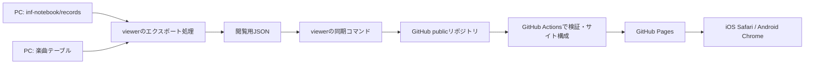

# inf-notebook-viewer 設計案

作成日: 2026-10-12。設計段階の提案であり、以下のコマンドやファイルは未実装。

## 採用案

Windows PCで記録を閲覧用JSONへ変換し、publicのinf-notebook-viewerリポジトリにpushする。GitHub Actionsで静的サイトを構成し、GitHub Pagesで配信する。スマホでは検索用一覧を取得し、選択した楽曲の履歴だけ追加取得する。



スマホからPCへの接続は不要。PCを停止しても、最後に公開した記録を閲覧できる。更新はpushとPagesのデプロイ完了後に反映される。

## 確定した要件

- 自分ひとりの記録を公開する。認証は不要。他の利用者はforkして自分のデータを公開する。
- SP、DP、DP BATTLEと、BEGINNER、NORMAL、HYPER、ANOTHER、LEGGENDARIAを対象にする。
- 曲名の部分一致検索と、プレイスタイル・難易度の選択を提供する。
- ベストスコア・最少BPと各オプション、および日付順の履歴を表示する。
- 履歴の項目は日付、クリアランプ、DJランク、スコア、BP、プレイ速度、オプション。
- 無料運用。オンラインのiOS/SafariとAndroid/Chromeを対象とする。
- inf-notebook本体は変更しない。実装・設定・自動化はviewer側に置く。
- 手動のコマンド更新を基本とし、自動更新を追加できる構成にする。

## 現行実装から確認したこと

- `export/score_results.html` は `score_results.js` を通じてWebSocketから楽曲テーブルと選択中の譜面の記録を取得する。そのままPagesへ置くだけでは、スマホで全楽曲を検索できない。
- `record.py` の `NotebookMusic` は曲名のUTF-8バイト列を16進数にした名前でJSONを保存する。曲名はファイル名から復元できる。
- 楽曲JSONはプレイスタイル→難易度→`best`、`history`、`timestamps`などの構造を持つ。
- `best`には、履歴に存在しない過去のベスト値や、オプション不明の値が入り得る。履歴から再計算せず、そのまま引き継ぐ。
- `summary.json` は履歴そのものではなく、項目名も楽曲JSONと異なる。履歴の情報源にはしない。
- 楽曲のレベルは楽曲テーブルを参照し、DP BATTLEではSPのレベルを使う。
- 楽曲テーブルは `resources/musictable*.res` にgzip圧縮されたpickleとして保存される。
- 2026-10-12に確認したローカルrecordsは1,778ファイル、13,263,506バイト（summary等を含む）。これは配信用JSONのサイズではない。
- `Notebook.save()` はファイルを直接書き換えるため、保存中の読み取りには対処が必要。

## 他の方式との比較

| 方式 | 利点 | この要件での判断 |
| --- | --- | --- |
| PCでJSON生成、GitHub Pagesで静的配信 | 無料、PC停止中も閲覧可能、運用が単純 | 採用 |
| recordsをそのままpush、Actionsで変換 | 変換処理をクラウドに集約できる | 不要な項目や元形式まで公開・保存する必要がないため、今回は採用しない |
| 自宅PCのWebサーバーを外部公開 | 記録を即時反映できる | PCの常時稼働と接続管理が必要。今回の利用には過剰 |
| DB・APIを持つホスティング | 複数利用者・認証・更新APIへ拡張しやすい | 現在の要件では管理する構成要素が増える |

## 構成と責務

```text
inf-notebook-viewer/
  web/                       HTML、CSS、JavaScript
  tools/export_records.py    読み取り・正規化・検証・JSON生成
  tools/sync.ps1             生成とGit同期
  tools/build_site.py         配信用ファイルとハッシュ付きURLの生成
  data/index.json            検索一覧・譜面の有無・レベル
  data/songs/<song-id>.json   楽曲単位の全スタイル・全難易度の履歴
  data/manifest.json         形式バージョン・更新情報
  config.example.json        設定例
  config.local.json          PCごとの設定、Git管理対象外
  .github/workflows/pages.yml
  docs/architecture.md
```

フロントエンドはHTML/CSSとJavaScript ES modulesで実装し、React等のフレームワークは初期版では使わない。PC側の変換はPython標準ライブラリ、同期はPowerShellとGitを使う。inf-notebookのPythonモジュールをimportしないため、その依存ライブラリや起動時の副作用を持ち込まない。

コードと閲覧用データは同じリポジトリのmainブランチで管理する。個人利用の初期規模では、データ専用ブランチや別リポジトリを設けるより扱いやすい。変更された楽曲ファイルのみコミットし、サイト全体はActions内で組み立てる。生のrecords、画像、PC上のパス、認証情報はコミットしない。

## エクスポート仕様

1. 設定されたrecordsパスから楽曲JSONだけを読み、recent/summary等は除外する。
2. ファイル名をUTF-8へ復号して曲名を取得する。
3. 既知の全スタイル・全難易度について、保存されたbestとhistoryを閲覧用形式へ変換する。
4. historyはtimestampsとの不整合を検査し、新しい日時から並べる。historyにあるがtimestampsにない項目は警告して保持し、timestampsのみ存在する欠損はエラーとする。
5. nullや古い記録の省略項目を扱い、欠落値を0や正規オプションと推測しない。
6. 検索一覧と楽曲別JSONを一時ディレクトリに生成し、全件検証に成功した後に出力を更新する。

楽曲IDは曲名のUTF-8から生成するSHA-256の全桁とする。ファイル名を短いASCIIに統一でき、曲名の記号や長さによるURLの問題を避けられる。表示名は元の曲名を保持する。

配信用形式には`schemaVersion`を設ける。bestはscore/missCountの値とオプション、historyは日時・各数値・ランプ・DJランク・速度・オプションを持つ。元データの`new`、`achievement`等の未使用項目は省く。元データを更新した際は生成をやり直して反映し、削除された楽曲の出力も除去する。

オプションはarrange/flip/battle/assistを既存画面と同じ意味で表示する。オプション全体がnullなら「不明」、既知の通常設定なら「正規」として区別する。ALL-SCR/REGUL-SPEED等の明示的なフラグも変換で保持し、該当時に文字列へ追加する。未知の旧形式を現在のフラグへ推測変換しない。

レベル取得には、設定で指定したローカルの楽曲テーブルを使う。初回は現在の`resources/musictable1.2.res`を指定する。複数の版がある場合にファイル名順で自動選択しない。信頼するinf-notebook由来のローカルpickleだけを読み、ブラウザやActionsではpickleを実行しない。配信するのは曲名とSP/DP別の難易度・レベルだけ。ファイル未指定ならレベルなしでも生成可能とし、「不明」と表示する。

検索対象は記録のある楽曲を基本とする。未プレイ楽曲を網羅した一覧は初期版に含めない。記録のある楽曲でも、選んだ譜面に記録がなければ「プレイ記録なし」と表示する。

## スマホの画面と読み込み

上から曲名検索、SP/DP/DP BATTLE選択、B/N/H/A/L選択、検索結果を置く。曲を選ぶと、曲名・レベル・譜面、ベストスコアと最少BP、履歴を表示する。

- 初回に取得するのはmanifestと検索一覧だけ。キー入力のたびに通信せず、一覧を端末上で検索する。
- 選んだ楽曲JSONだけ追加取得する。同じ楽曲のスタイル・難易度切り替えでは再取得しない。
- 元のテーブルと同じ項目・日付降順を維持する。狭い画面では行を2段にし、オプションを折り返す。オプション確認に横スクロールを要求しない。
- 長い履歴は最新50件から表示し、「さらに表示」で追加する。取得データは全履歴を保持する。
- 選択したスタイルと難易度はlocalStorageへ保存する。曲・スタイル・難易度はURLにも反映し、戻る操作やブックマークに対応する。
- 読み込み中、通信エラー、検索結果なし、記録なし、未知の数値を区別する。
- データ公開日時と最新プレイ日時を別々に表示する。
- スコア・BPを読み取りやすくし、オプションは省略せず表示する。ランプは色に加え文字で意味を伝える。
- 曲名等はtextContentで描画する。既存コードのHTML文字列埋め込みは引き継がない。
- URLは相対パスで解決し、fork後の`/<repository>/`配下でも動作させる。

検索は表示名を変更せず、検索専用の文字列と入力に同じ正規化を適用する。NFKC、英字の小文字化、カタカナからひらがなへの変換、ラテン文字のアクセント除去を行う。濁点・半濁点は保持する。「ガ」と「カ」を同一視しない。略称辞書やローマ字変換は初期版の対象外。Safari/Chromeで代表的な曲名と入力を検証する。

## 手動更新の流れ

初回のみ、viewer用のpublicリポジトリを作成またはforkし、Gitのpush認証を設定する。PythonとGitを用意し、local設定にinf-notebookのパスと楽曲テーブルのパスを指定する。GitHub側ではPagesのSourceをGitHub Actionsに設定する。

想定コマンドは次の通り（未実装）。

```powershell
# ローカル生成・検証。GitHubには送信しない
python tools/export_records.py --config config.local.json

# 生成・検証し、変更があればデータをcommitしてpush
pwsh -File tools/sync.ps1
```

同期コマンドは生成前にブランチと作業状態を検査する。無関係な未コミット変更がある場合は停止し、`git add .`を使わず生成データだけを対象にする。同期用の専用checkoutを推奨し、開発中のcheckoutと分ける。

remoteの更新はfast-forwardで取り込む。履歴が分岐した場合は停止して案内し、force pushや自動的な変更破棄は行わない。push前のデータに差分がなければ新しいcommitを作らない。取得・公開日時だけの変更で毎回差分を発生させない。

生成後に通信が失敗しても、生成データと未送信commitを残す。次回は未送信commitのpushも確認し、「データ差分なし」を理由に送信を飛ばさない。push成功とPages公開成功は別の状態として表示し、手動実行時は公開状況へのリンクを返す。

## GitHub Actionsとキャッシュ

mainへのpushとworkflow_dispatchで検証・サイト構成・デプロイを実行する。デプロイ対象はmainのみとし、PRの検証では公開しない。Pages用の権限はデプロイジョブに限定し、標準のUbuntu runnerと公式Pagesアクションを使う。

ActionsはPCのrecordsを取得しない。PCがpushした閲覧用JSONの形式、参照整合性、フロントエンドとの互換性を検証する。失敗した場合はデプロイせず、公開済みサイトを維持する。連続pushにはconcurrencyを設定し、古い待機ジョブをまとめる。

検索一覧と楽曲JSONの配信用ファイル名に内容ハッシュを含める。Git管理上は安定した名前を使い、ハッシュ付きファイルはActionsで生成する。manifestは再検証付きで取得し、一覧からその版の楽曲ファイルを参照する。開いたままの画面で旧版のファイルが取得できなくなった場合はmanifestを再取得して一度だけ読み直す。高速な選曲で取得が前後しても、最後に選択した楽曲だけを表示する。

Service Workerとオフライン対応は初期版に含めない。ページを開き直すと最新manifestを確認し、手動の「データを更新」操作も用意する。

## 自動更新の提案

最初は手動更新を完成させ、その同じ同期コマンドをWindowsタスクスケジューラから実行する方式を追加する。

- 推奨: PCのログオン時と、ログオン中の30分間隔で実行。
- タスクの実行ユーザーはGit認証を設定した本人。並列起動は抑止する。
- データに差分がなければpushもActions実行も発生しない。
- PC停止中は同期されず、スマホには最後に公開したデータが表示される。
- 保存中のファイルは読み取り前後の更新状態を確認し、JSON解析失敗や更新検出時に短い間隔で再試行する。回復しなければ全体の公開を中止する。
- inf-notebook側のロック機構を使えないため、全ファイルの厳密な同時点スナップショットは保証しない。静止後の手動同期が最も確実。
- ログはviewer側に保存する。エラーは終了コードに反映し、次回の実行で再試行する。

常駐のファイル監視は低遅延にできるが、保存途中の検出や連続更新をまとめる処理が増えるため初期版では採用しない。GitHub Actionsのscheduleだけでは、PCの未アップロードデータを取得できない。公開リポジトリからPC上のジョブを実行するself-hosted runnerも不要。

## 無料運用と容量

publicリポジトリのGitHub PagesはGitHub Freeで利用できる。publicリポジトリの標準GitHub-hosted runnerも無料。独自ドメイン、大型runner、有料サービスは不要。

Pagesの公開サイトは最大1GB、帯域は月100GBのsoft limit。現在の元データ約13.3MBと個人利用の想定から、今回の構成は十分小さい。ただし生成後の容量と初期取得量は実装時に計測する。Actionsの一般artifact/cacheを長期保存せず、Pages用artifactの保持を短くし、有料のストレージ増枠は設定しない。

Gitには過去のデータ版も残るため、公開データの削除とGit履歴からの除去は別である。容量が大きくなった場合はデータ保存先の分離を再検討するが、初期版から履歴書き換えを自動化しない。

## 実装時の確認項目

- 実データから全スタイル・難易度を読み取り、元のbest・履歴件数・オプションと一致する。
- 過去形式、null、BP=0、履歴にないbest、オプション不明、速度なしを正しく扱う。
- 曲名の記号・長い文字列、かな・半角・アクセント検索を扱う。
- 生成を再実行しても、元データが変わらなければ差分が出ない。
- 保存途中・不正JSON・参照欠損時に、不完全なデータを公開しない。
- 削除済み記録、push失敗後の再実行、並列起動、Git履歴の分岐を扱う。
- Pagesのリポジトリ配下で動き、旧版キャッシュから回復する。
- iOS/SafariとAndroid/Chromeの狭い画面で検索・選択・履歴表示を確認する。
- 個人のデータ・ローカル設定を他のfork利用者の初期サンプルとして固定しない。fork直後は自分のデータへの置き換えを案内し、サンプルは架空データを使う。

## 推奨する実装順序

1. JSON変換と形式検証、ローカルでの検索・履歴表示。
2. 手動同期とGitHub Pagesのデプロイ。
3. スマホでの表示確認とキャッシュ更新処理。
4. Windowsタスクスケジューラ用の登録・解除コマンドと運用説明。

## 参考資料

- [GitHub Pagesの制限](https://docs.github.com/en/pages/getting-started-with-github-pages/github-pages-limits)
- [GitHub Actionsの課金と無料利用](https://docs.github.com/en/billing/concepts/product-billing/github-actions)
- [GitHub Pages用のカスタムワークフロー](https://docs.github.com/en/pages/getting-started-with-github-pages/using-custom-workflows-with-github-pages)

GitHubの条件は2026-10-12時点で公式資料を確認したもの。
